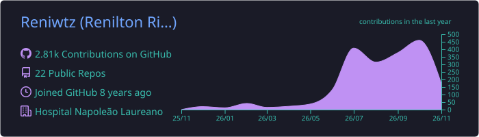

# Olá, eu sou Renilton Ribeiro 👋

🎓 Graduado em Ciência da Computação pela Universidade Federal da Paraíba (UFPB)

- 🔭 Analista de Sistemas no Hospital Napoleão Laureano
- 💻 Apaixonado por Desenvolvimento Web, DevOps, Banco de Dados, Linux e Infraestrutura
- ⚡ Fã de Cultura POP e Rock
- 💬 Pergunte-me qualquer coisa

---

---

## 🚀 Linguagens

      

---

## 🌐 Frameworks & Bibliotecas

                

---

## 📄 Relatórios & Documentos

       

---

## 🗄️ Banco de Dados

     

---

## ⚙️ DevOps & Infraestrutura

           

---

## 🔗 Integração & Automação

[-0078D4?style=for-the-badge&logo=microsoft&logoColor=white)](https://learn.microsoft.com/windows-server/identity/ad-ds/get-started/virtual-dc/active-directory-domain-services-overview)           

---

## 🤖 Inteligência Artificial

   

---

## 🛠 Ferramentas

     
---

## 💻 Sistemas Operacionais

  

---

## 📫 Onde me encontrar

---

<picture>
<source media="(prefers-color-scheme: dark)" srcset="https://raw.githubusercontent.com/Reniwtz/Reniwtz/output/snake-dark.svg">

<source media="(prefers-color-scheme: light)" srcset="https://raw.githubusercontent.com/Reniwtz/Reniwtz/output/snake.svg">

</picture>
